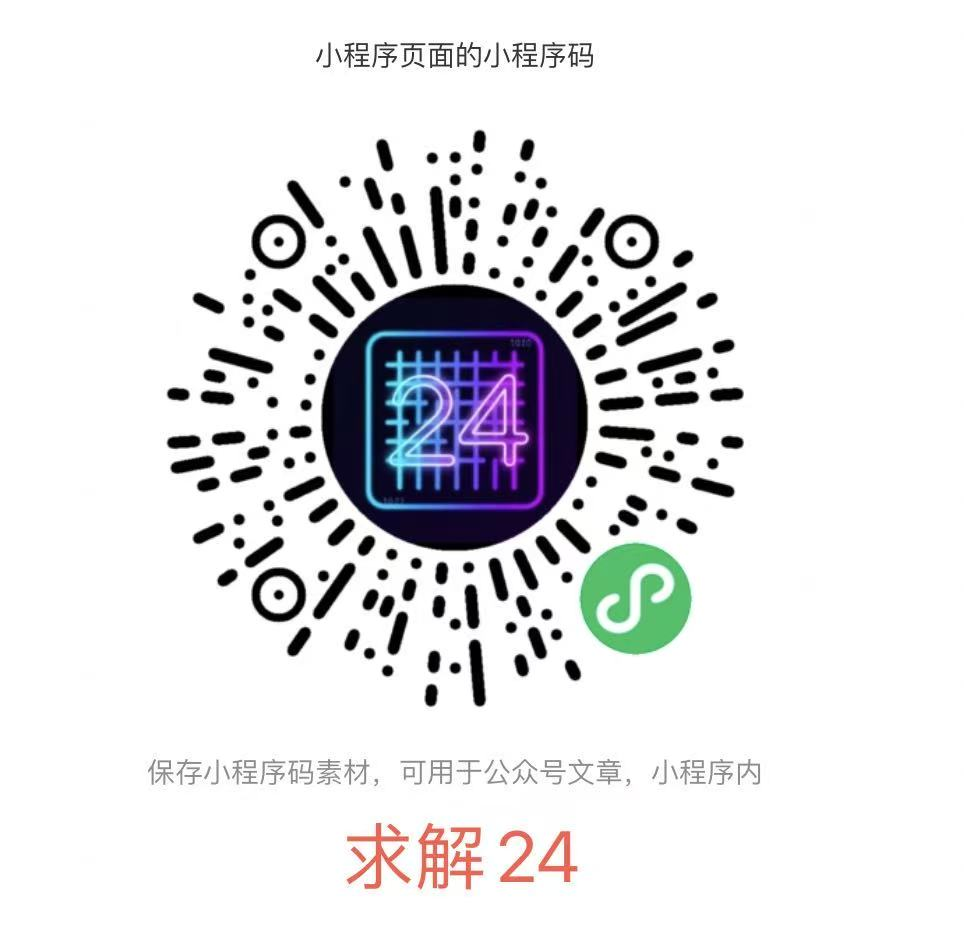

> 通过vibe coding开发了一些益智小游戏。包含经典的算24点游戏、类2048游戏2424!、类只有一道门、猜数字密码破解等小游戏，以及其他的经典益智类数字游戏如数独、华容道、谐音梗等免费游戏。游戏也适合中小学生培养数学兴趣和锻炼思维能力。

---

## 一、Web游戏链接

+ [jiao.oaij.art](https://jiao.oaij.art)
+ [游戏本站链接](https://easingboy.github.io/play.html)
+ [游戏axureshow托管](https://www.axxiu.cn/project/LT1ltJ7G/)

## 二、微信游戏链接

## 三、其他

+ [文件中转站:https://file.long0617.cn/](https://file.long0617.cn/)
+ [开放聚玩:FC和街机:https://openjw.com/games/](https://openjw.com/games/)
+ [页面托管:https://html.npin.cn/index.php](https://html.npin.cn/index.php)
+ [机地游戏PC和FC:https://jidiyouxi.com/](https://jidiyouxi.com/)
+ [https://game.hullqin.cn/](https://game.hullqin.cn/)
+ [在线玩nes:https://zaixianwan.app/consoles/nes](https://zaixianwan.app/consoles/nes)
+ [https://zh.boardgamearena.com/](https://zh.boardgamearena.com/)
+ [https://www.astrocade.com/](https://www.astrocade.com/)
+ [https://ohmygame.net/](https://ohmygame.net/)
